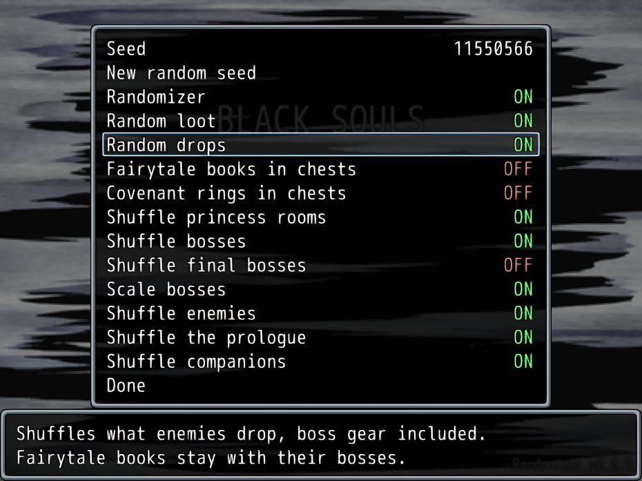

# BLACK SOULS Randomizer

A randomizer for BLACK SOULS. Works with the Steam release and the English 2019 release.

## Install

Download BlackSouls_Randomizer.zip from [Releases](../../releases), unzip it and run BlackSouls_Randomizer.exe. Pick your game folder and it makes a new "BLACK SOULS Randomizer" folder next to your game, leaving your normal game and saves alone. If you have Python you can run install.py instead.

Start Game.exe in the new folder and open Randomizer Options on the title screen to set the seed and options. Every New Game rolls its world from those settings and writes a spoiler log to the Randomizer folder.

## What it shuffles

- Loot, with the Invitation to Atlantica always placed where you can reach it
- The rooms of the four demonic princesses (Princess Frog can be found at Atlantica for example)
- Bosses, including story fights like the prologue dragon and Behemoth, scaled to the fight they replace.
- Enemy groups, including the prologue, scaled the same way
- Companions (Leaf, Dorothy, Elma, Victoria, Goose, Jeanne, Miranda, Red Hood, Catherine and Elisabeth). Where you would meet one companion you get another instead. The scene keeps its place and dialogue but shows her walking sprite, and she then waits at her usual spot in the Holy Forest and acts as she normally does

## Quality of life

### Controller support

Xbox controllers work directly. A confirms, B cancels, X runs and Start opens the menu.

### Window sizing

Drag the window bigger or press F6 to step through sizes.
